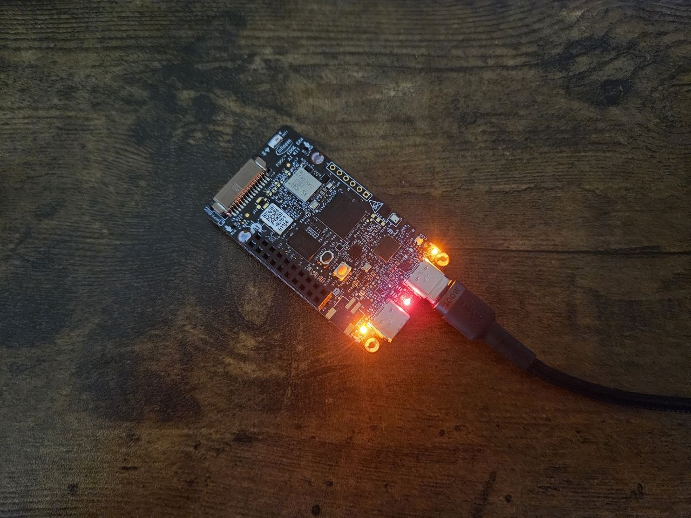
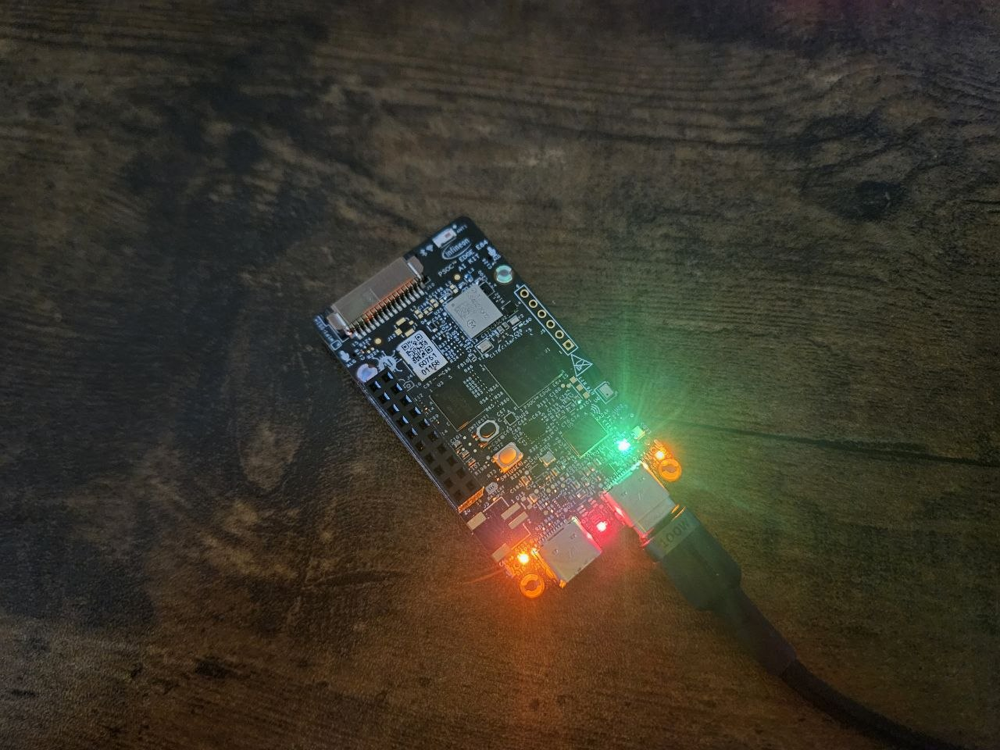
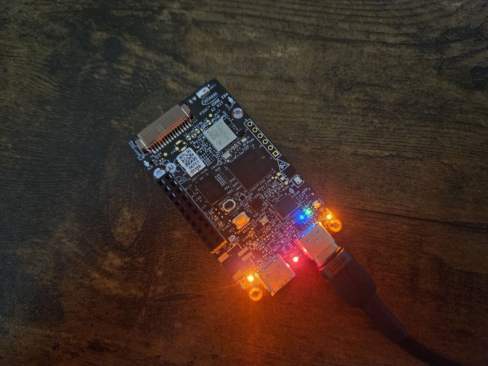
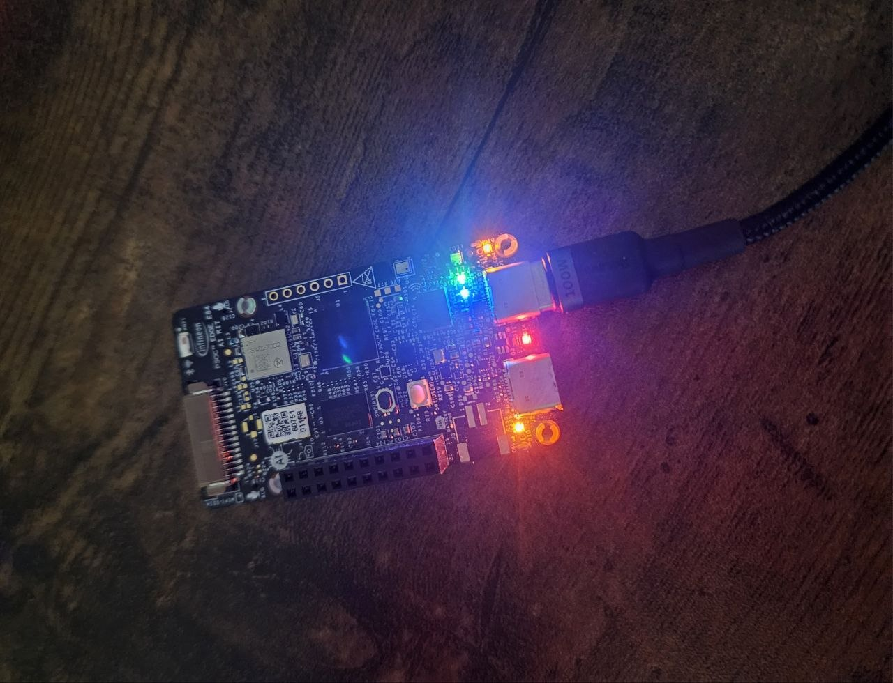
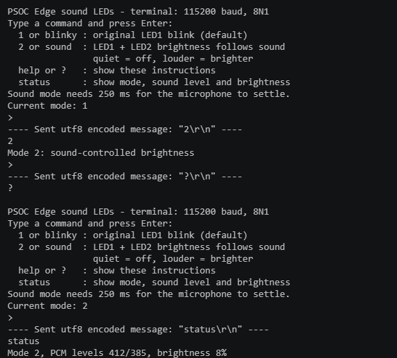

# PSOC™ Edge MCU: Sound-controlled LEDs

This application uses an Arm® Cortex®-M33 CPU on PSOC™ Edge MCU to provide terminal-selectable LED blinking and microphone-controlled LED brightness.

## Sound-controlled LED modes

The CM33 non-secure application starts in the original blink mode. Connect the  
KitProg debug serial terminal at **115200 baud, 8 data bits, no parity, 1 stop**  
**bit, no flow control**. Type a command and press **Enter**:

| Command | Behavior |
| --- | --- |
| 1 | LED1 toggles every second; LED2 stays off. This is the default after reset. |
| 2 | The onboard PDM microphone controls LED1 and LED2 brightness. Quiet turns them off; increasing sound makes them brighter. |
| 3 | Print terminal instructions. |
| 4 | Print the selected mode, both microphone PCM levels, and sound brightness percentage. |
| 5 | Measure quiet room noise again in sound mode; keep quiet for 1.25 seconds. |

Commands use only the numbers shown above. Instructions print at startup and every ten seconds  
until the first terminal input, because the debug UART does not signal when a  
terminal is opened. When reconnecting after using the terminal, type `3` and press Enter to  
show the instructions again. Mode selections last until reset.

Sound mode uses the BSP's PDM configuration, both microphone channels (2 and 3),  
DC filtering, and mean absolute amplitude over 256 samples per channel. The  
louder channel controls both LEDs with 200 Hz software PWM. After selecting sound  
mode, keep quiet for 1.25 seconds: the microphone settles for 250 ms and then  
measures room noise for one second. Both LEDs stay off during calibration. The  
quiet cutoff is the measured noise level plus a 50% margin and 80 PCM units.  
Sound at or below this cutoff sets brightness to exactly zero. The interrupt  
updates brightness even while terminal output is being printed, so returning to  
quiet turns both LEDs fully off. Missing samples for 100 ms also turn them off.

Real microphones produce some noise even in a quiet room. Use `5` to  
remeasure the quiet level if the room changes. `4` shows the quiet cutoff  
and whether calibration is in progress. In `proj_cm33_ns/sound_led_controller.c`,  
`SOUND_NOISE_FLOOR` (default 80) is the extra calibration margin, and  
`SOUND_BRIGHTNESS_RANGE` (default 4000) is the signal above the cutoff needed for  
maximum brightness. Brightness increases linearly above the cutoff.

`proj_cm33_ns/led_modes_main.c` contains application startup;  
`sound_led_controller.c` and `sound_led_controller.h` contain the microphone,  
LED mode control, PWM, and terminal commands.

Build and program using the existing ModusToolbox workflow. To check on hardware:  
verify the default blink, select `2`, check that quiet switches the LEDs off and  
speech/claps increase their brightness, then select `1` to return to blinking.  
Also check `3`, `4`, and opening the terminal after the board has booted.

## Demo

### Mode 1 – Blink (command `1`)

| LED off | LED on |
|---------|--------|
|  |  |

LED1 toggles every second. LED2 stays off.

### Mode 2 – Sound-controlled brightness (command `2`)

| Low brightness (quiet) | High brightness (loud) |
|------------------------|------------------------|
|  |  |

The onboard microphone controls the brightness of both LEDs. Quiet turns them off; louder sound makes them brighter.

### Terminal commands

## Requirements

* [ModusToolbox™](https://www.infineon.com/modustoolbox) v3.7 or later (tested with v3.7)
* Board support package (BSP) minimum required version: 1.0.0
* Programming language: C
* Associated parts: All [PSOC™ Edge MCU](https://www.infineon.com/products/microcontroller/32-bit-psoc-arm-cortex/32-bit-psoc-edge-arm) parts

Ensure the following jumper and pin configuration on board.

* BOOT SW must be in the HIGH/ON position
* J20 and J21 must be in the tristate/not connected (NC) position for the PSOC™ Edge E84 Evaluation Kit
