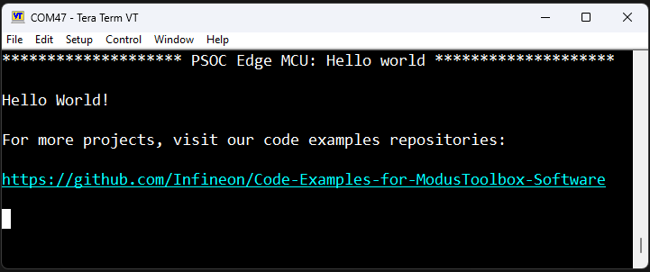

# PSOC&trade; Edge MCU: Sound-controlled LEDs

This application uses an Arm&reg; Cortex&reg;-M33 CPU on PSOC&trade; Edge MCU to provide terminal-selectable LED blinking and microphone-controlled LED brightness.

This code example has a three project structure: CM33 secure, CM33 non-secure, and CM55 projects. All three projects are programmed to the external QSPI flash and executed in Execute in Place (XIP) mode. Extended boot launches the CM33 secure project from a fixed location in the external flash, which then configures the protection settings and launches the CM33 non-secure application. Additionally, CM33 non-secure application enables CM55 CPU and launches the CM55 application.
> **Note:** On the KIT_PSE84_HMI, all three projects are programmed to the external OSPI flash instead of QSPI.

[Provide feedback on this code example.](https://yourvoice.infineon.com/jfe/form/SV_1NTns53sK2yiljn?Q_EED=eyJVbmlxdWUgRG9jIElkIjoiQ0UyMzg1NDEiLCJTcGVjIE51bWJlciI6IjAwMi0zODU0MSIsIkRvYyBUaXRsZSI6IlBTT0MmdHJhZGU7IEVkZ2UgTUNVOiBIZWxsbyB3b3JsZCIsInJpZCI6ImhpbWFuc2h1LnNoZWtoYXJAaW5maW5lb24uY29tIiwiRG9jIHZlcnNpb24iOiIyLjEuMCIsIkRvYyBMYW5ndWFnZSI6IkVuZ2xpc2giLCJEb2MgRGl2aXNpb24iOiJNQ0QiLCJEb2MgQlUiOiJJQ1ciLCJEb2MgRmFtaWx5IjoiUFNPQyJ9)

See the [Design and implementation](docs/design_and_implementation.md) for the functional description of this code example.

## Sound-controlled LED modes

The CM33 non-secure application starts in the original blink mode. Connect the
KitProg debug serial terminal at **115200 baud, 8 data bits, no parity, 1 stop
bit, no flow control**. Type a command and press **Enter**:

| Command | Behavior |
| --- | --- |
| `1` | LED1 toggles every second; LED2 stays off. This is the default after reset. |
| `2` | The onboard PDM microphone controls LED1 and LED2 brightness. Quiet turns them off; increasing sound makes them brighter. |
| `3` | Print terminal instructions. |
| `4` | Print the selected mode, both microphone PCM levels, and sound brightness percentage. |
| `5` | Measure quiet room noise again in sound mode; keep quiet for 1.25 seconds. |

Commands use only the numbers shown above. Instructions print at startup and every ten seconds
until the first terminal input, because the debug UART does not signal when a
terminal is opened. When reconnecting after using the terminal, type `3` and press Enter to
show the instructions again. Mode selections last until reset.

Sound mode uses the BSP's PDM configuration, both microphone channels (2 and 3),
DC filtering, and mean absolute amplitude over 256 samples per channel. The
louder channel controls both LEDs with 200 Hz software PWM. After selecting sound
mode, keep quiet for 1.25 seconds: the microphone settles for 250 ms and then
measures room noise for one second. Both LEDs stay off during calibration. The
quiet cutoff is the measured noise level plus a 50% margin and 80 PCM units.
Sound at or below this cutoff sets brightness to exactly zero. The interrupt
updates brightness even while terminal output is being printed, so returning to
quiet turns both LEDs fully off. Missing samples for 100 ms also turn them off.

Real microphones produce some noise even in a quiet room. Use `5` to
remeasure the quiet level if the room changes. `4` shows the quiet cutoff
and whether calibration is in progress. In `proj_cm33_ns/sound_led_controller.c`,
`SOUND_NOISE_FLOOR` (default 80) is the extra calibration margin, and
`SOUND_BRIGHTNESS_RANGE` (default 4000) is the signal above the cutoff needed for
maximum brightness. Brightness increases linearly above the cutoff.

`proj_cm33_ns/led_modes_main.c` contains application startup;
`sound_led_controller.c` and `sound_led_controller.h` contain the microphone,
LED mode control, PWM, and terminal commands.

Build and program using the existing ModusToolbox workflow. To check on hardware:
verify the default blink, select `2`, check that quiet switches the LEDs off and
speech/claps increase their brightness, then select `1` to return to blinking.
Also check `3`, `4`, and opening the terminal after the board has booted.

## Requirements

- [ModusToolbox&trade;](https://www.infineon.com/modustoolbox) v3.7 or later (tested with v3.7)
- Board support package (BSP) minimum required version: 1.0.0
- Programming language: C
- Associated parts: All [PSOC&trade; Edge MCU](https://www.infineon.com/products/microcontroller/32-bit-psoc-arm-cortex/32-bit-psoc-edge-arm) parts

## Supported toolchains (make variable 'TOOLCHAIN')

- GNU Arm&reg; Embedded Compiler v14.2.1 (`GCC_ARM`) – Default value of `TOOLCHAIN`
- Arm&reg; Compiler v6.22 (`ARM`)
- IAR C/C++ Compiler v9.50.2 (`IAR`)
- LLVM Embedded Toolchain for Arm&reg; v19.1.5 (`LLVM_ARM`)

## Supported kits (make variable 'TARGET')

- [PSOC&trade; Edge E84 Evaluation Kit](https://www.infineon.com/KIT_PSE84_EVAL) (`KIT_PSE84_EVAL_EPC2`) – Default value of `TARGET`
- [PSOC&trade; Edge E84 Evaluation Kit](https://www.infineon.com/KIT_PSE84_EVAL) (`KIT_PSE84_EVAL_EPC4`)
- [PSOC&trade; Edge E84 AI Kit](https://www.infineon.com/KIT_PSE84_AI) (`KIT_PSE84_AI`)
- [PSOC&trade; Edge E84 HMI Kit](https://www.infineon.com/KIT_PSE84_HMI) (`KIT_PSE84_HMI`)

## Hardware setup

This example uses the board's default configuration. See the kit user guide to ensure that the board is configured correctly.

Ensure the following jumper and pin configuration on board.
- BOOT SW must be in the HIGH/ON position
- J20 and J21 must be in the tristate/not connected (NC) position for the PSOC&trade; Edge E84 Evaluation Kit

> **Note:** This hardware setup is not required for KIT_PSE84_AI.

## Software setup

See the [ModusToolbox&trade; tools package installation guide](https://www.infineon.com/ModusToolboxInstallguide) for information about installing and configuring the tools package.

Install a terminal emulator if you do not have one. Instructions in this document use [Tera Term](https://teratermproject.github.io/index-en.html).

This example requires no additional software or tools.

## Operation

See [Using the code example](docs/using_the_code_example.md) for instructions on creating a project, opening it in various supported IDEs, and performing tasks, such as building, programming, and debugging the application within the respective IDEs.

1. Connect the board to your PC using the provided USB cable through the KitProg3 USB connector

2. Open a terminal program and select the KitProg3 COM port. Set the serial port parameters to 8N1 and 115200 baud

3. After programming, the application starts automatically. Confirm that "PSOC Edge MCU: Sound-controlled LEDs" is displayed on the UART terminal

   **Figure 1. Terminal output on program startup**

   

4. Confirm that the kit 'User LED1' blinks at approximately 1 Hz
